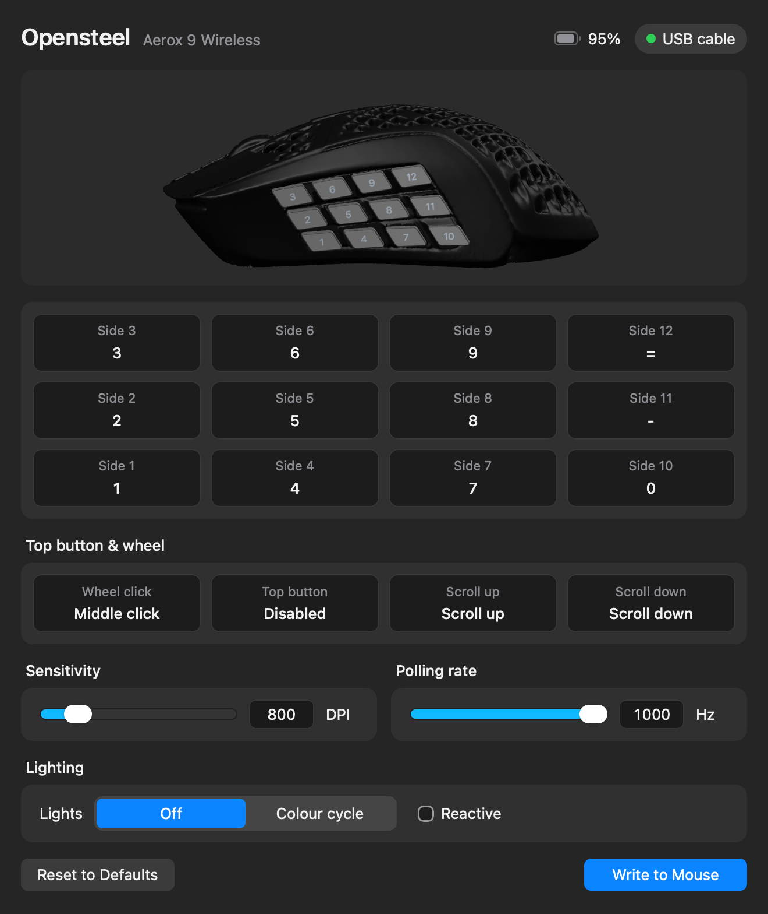

# opensteel

A simple tool to remap your Steelseries Aerox 9 mouse.



**[Download for Windows, macOS or Linux](https://jetsmoke.github.io/Opensteel/)**

- Easily remap all keys and save them to memory
- Works over USB, the 2.4 GHz dongle and Bluetooth.

## Linux

Run this once so the AppImage can reach the mouse:

```bash
sudo curl -Lo /etc/udev/rules.d/70-opensteel.rules https://raw.githubusercontent.com/Jetsmoke/Opensteel/main/desktop/src-tauri/linux/70-opensteel.rules
sudo udevadm control --reload-rules && sudo udevadm trigger --subsystem-match=hidraw
```

## Building

- **macOS app** (`macos/`): Swift, SwiftUI and SceneKit, no Xcode project.
  Run `macos/build.sh`.
- **Windows and Linux app** (`desktop/`): [Tauri](https://tauri.app). Rust talks to the
  mouse through hidapi; the window is the web page in `desktop/ui`. With Rust and the
  [Tauri prerequisites](https://tauri.app/start/prerequisites/) installed, run
  `cargo tauri build` in `desktop/src-tauri`.

Pushing a tag like `v0.2.0` builds all three and publishes a GitHub release
(`.github/workflows/release.yml`).

## Credits

- The button-mapping protocol was first worked out by the
  [rivalcfg](https://github.com/flozz/rivalcfg) project.
- The 3D mouse is "Steelseries Aerox 9" by [Scout339](https://www.printables.com/@Scout339)
  ([CC BY-SA 4.0](https://creativecommons.org/licenses/by-sa/4.0/)); see `model/`.

Opensteel's own code is public domain ([Unlicense](LICENSE)). It isn't affiliated with
SteelSeries.
